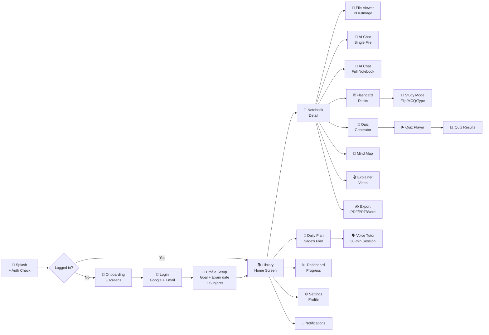

# 📚 TRUE ME — Master Engineering Blueprint

> **Version 1.0 | Last Updated: Nov 7, 2026**  
> AI-Powered All-in-One Study App | Flutter (iOS + Android + Web)  
> Target: University/College Students | 100% Free | English  
> Solo Developer Build

---

## 1. 🎯 App Identity

| Field | Value |
|---|---|
| **App Name** | True Me |
| **AI Companion Name** | Sage (the Mother AI) |
| **Platform** | Flutter — iOS + Android + Web (single codebase) |
| **Target Users** | University & College Students |
| **Business Model** | 100% Free — no paid plans |
| **Language** | English (expand later) |
| **UI Style** | Apple Liquid Glass — glassmorphism, blur, specular glow |
| **UI Reference** | [liquidGL library](https://github.com/naughtyduk/liquidGL) (style inspiration) |

---

## 2. 🏗️ Full System Architecture

```mermaid
flowchart TD
    APP["📱 True Me Flutter App\niOS + Android + Web"]

    APP --> SAGE["🧠 Sage — Mother AI\nGemini 1.5 Flash\n+ Function Calling\n+ Persistent Memory"]
    APP --> FIREBASE["🔥 Firebase\nAuth + Firestore + FCM"]
    APP --> SUPABASE["🗄️ Supabase\nPostgreSQL + pgvector\n+ File Cache"]
    APP --> DRIVE["☁️ User Cloud Storage\nGoogle Drive / OneDrive / Dropbox\n(User's own — Unlimited)"]

    SAGE --> GEMINI["Gemini 1.5 Flash\nMother AI + Embeddings"]
    SAGE --> GROQ8B["Groq LLaMA 3.1 8B\nFlashcards + Quiz + YT"]
    SAGE --> GROQ70B["Groq LLaMA 3.1 70B\nAI Chat + Mind Maps"]
    SAGE --> CF["Cloudflare Workers AI\nSummarization"]
    SAGE --> POLL["Pollinations.ai FLUX\nImage Generation"]
    SAGE --> DEVICE["📱 Device Engine\nSTT + TTS + OCR\nFree + Offline"]
```



---

## 3. 🤖 AI Provider Distribution (The Core Rule)

> **Gemini does only 2 things.** Everything else has its own provider. No single point of failure.

| Feature | AI Provider | Daily Free Limit | CC Needed? |
|---|---|---|---|
| 🧠 Mother AI (Sage) daily analysis | Gemini 1.5 Flash | 1,500 req/day | ✅ No |
| 📄 Document embeddings (RAG) | Gemini text-embedding-004 | 1,500 req/day | ✅ No |
| 🃏 Flashcard generation | Groq LLaMA 3.1 8B | 14,400 req/day | ✅ No |
| 📝 Quiz generation | Groq LLaMA 3.1 8B | 14,400 req/day | ✅ No |
| 📺 YouTube summarizer | Groq LLaMA 3.1 8B | 14,400 req/day | ✅ No |
| 🎬 Explainer video script | Groq LLaMA 3.1 8B | 14,400 req/day | ✅ No |
| 💬 AI Chat with notes (RAG) | Groq LLaMA 3.1 70B | 1,000 req/day | ✅ No |
| 🗺️ Mind map generation | Groq LLaMA 3.1 70B | 1,000 req/day | ✅ No |
| 📃 Text summarization | Cloudflare Workers AI | 10,000/day | ✅ No |
| 🌐 Web page summarizer | Cloudflare Workers AI | 10,000/day | ✅ No |
| 🖼️ Image generation | Pollinations.ai FLUX | ♾️ Unlimited | ✅ No key |
| 🔍 OCR (images/handwriting) | Google ML Kit (on-device) | ♾️ Unlimited | ✅ Offline |
| 🎙️ Voice input (STT) | flutter `speech_to_text` | ♾️ Unlimited | ✅ Offline |
| 🔊 Voice output (TTS) | flutter `flutter_tts` | ♾️ Unlimited | ✅ Offline |
| 🎵 Audio transcription | Groq Whisper Large v3 | 7,200 req/day | ✅ No |
| 📄 PDF/PPTX/DOCX export | Flutter packages (on-device) | ♾️ Unlimited | ✅ No API |

**Total combined AI capacity: ~26,900 AI calls/day**

### Fallback Chain (auto-switches, user never sees error):
```
Gemini Flash → (if limit hit) → Groq 70B → (if limit hit) → Groq 8B → (if limit hit) → Cloudflare → OpenRouter Free
```

---

## 4. 🧠 Sage — The Mother AI

Every registered user gets their own persistent AI agent called **Sage**.

### What Sage Does Daily (Background, 6 AM):
1. Reads user's full profile + 7-day activity from Firestore
2. Identifies weak subjects + mastery decay (SM-2 algorithm)
3. Calculates exam countdown urgency
4. Generates optimized study plan for today
5. Adjusts difficulty settings per subject
6. Sends personalized morning push notification

### Sage's Tools (Function Calling — real actions):
```dart
analyzeWeakAreas()         // find topics scoring < 70%
updateStudyPlan(plan)      // write today's schedule to Firestore
generateFlashcardDeck(topic)  // trigger Groq to make cards
scheduleQuiz(topic, diff)  // create adaptive quiz
sendNotification(msg, time)   // Firebase FCM push
adjustDifficulty(subj, lvl)   // raise/lower content level
logStudySession(data)      // save session stats
computeNextReviewDates()   // SM-2 spaced repetition
getUserFullProfile()       // read all data from Firestore
```

### Adaptive Difficulty Logic:
```
Quiz Score > 85%  → Raise difficulty, introduce harder topics
Quiz Score 70–85% → Keep same level, good progress
Quiz Score 50–70% → Slight reduction, more practice
Quiz Score < 50%  → Play explanation video first, retry after
No study 3+ days  → Reduce plan size, gentle notification
Exam < 3 days     → Full revision mode — no new content
```

### Sage System Prompt (injected with live user data):
```
You are Sage — the personal AI study coach for {userName} inside True Me.
You know everything about this student.

Student Profile: {profile_json}
Today's Date: {date} | Days Until Exam: {countdown}
Today's Plan: {study_plan}
Last 7 Days Performance: {weekly_summary}

Personality: Encouraging, direct, specific — like a smart senior student.
Always use their actual data. Never give generic advice.
Take real actions using your tools when needed.
```

---

## 5. 📱 App Features — Complete List

### Core Study Features
| Feature | Implementation | AI Provider |
|---|---|---|
| 📁 Smart Notebook Library | Firestore collections + tags | — |
| 📄 PDF Upload & Chat | Supabase storage + pgvector RAG | Gemini embeddings + Groq 70B chat |
| ✍️ Manual Rich Text Notes | flutter_quill editor + Firestore | — |
| 🌐 Web Page Import | http fetch + HTML parse | Cloudflare (summarize) |
| 🎙️ Voice Notes (record → structured notes) | `record` package → Groq Whisper | Groq Whisper + Groq 8B |
| 🖼️ Image/Handwriting OCR | Google ML Kit on-device | On-device (free) |
| 📺 YouTube Link Summarizer | YouTube transcript API + Groq | Groq LLaMA 3.1 8B |

### AI-Powered Study Tools
| Feature | Implementation | AI Provider |
|---|---|---|
| 🤖 AI Chat with Notebook | RAG (pgvector similarity search) | Groq LLaMA 3.1 70B |
| 🃏 Flashcard Generator | Auto from any content | Groq LLaMA 3.1 8B |
| 📝 Quiz Generator (MCQ, T/F, Fill) | Structured JSON output | Groq LLaMA 3.1 8B |
| 🧩 Mind Map Generator | JSON → interactive graph | Groq LLaMA 3.1 70B |
| 🎬 10-min Explainer Video | AI script → Flutter animations + TTS | Groq 8B (script) + Device TTS |
| 🗣️ 30-min AI Voice Tutor | STT → Groq → TTS loop | Device STT + Groq + Device TTS |
| 📅 AI Study Planner | Sage daily plan generation | Gemini Flash (Sage) |
| 🏆 Spaced Repetition (SM-2) | Custom SM-2 algorithm in Dart | On-device algorithm |

### Document Export
| Output | Flutter Package | AI Role |
|---|---|---|
| PDF | `pdf` + `printing` | Gemini/Groq generates content, Flutter exports |
| PowerPoint (.pptx) | `pptx` | AI generates slide structure as JSON |
| Word (.docx) | `docx_template` | AI generates content, Flutter packages it |
| Formatted Notes | `flutter_quill` → export | Rich text editor export |

### Progress & Gamification
| Feature | Detail |
|---|---|
| 🔥 Study streak tracker | Daily login + study session required |
| ⏱️ Total study time | Per subject, all-time, weekly |
| 📊 Mastery score per topic | 0–100%, based on quiz history |
| 📈 Performance trends | 7-day chart per subject |
| 🏅 Achievement badges | Streaks, milestones, improvement |

---

## 6. 🗄️ Database Architecture

### Firebase Firestore Structure
```
users/
  {userId}/
    profile/
      name, email, avatar, learningStyle, studyGoal
      examDate, subjects[], preferredStudyTime
      createdAt, lastActive
    
    stats/
      currentStreak, longestStreak
      totalStudyMinutes, totalQuizzes
      averageQuizScore, totalFlashcardsReviewed
    
    subjectPerformance/
      {subject}/
        mastery (0-100)
        trend (improving/stable/struggling/critical)
        quizHistory[]
        lastStudied
    
    studyPlan/
      {date}/
        sessions[]
        totalTargetMinutes
        motivationalMessage
        completed (bool)
    
    notebooks/
      {notebookId}/
        title, subject, color, tags[]
        createdAt, lastModified
        fileRefs[] (Supabase paths)
    
    flashcardDecks/
      {deckId}/
        notebookId, subject, topic
        cards[]
          front, back, imageUrl
          easeFactor, interval, repetitions (SM-2)
          nextReviewDate, lastReviewDate
    
    quizHistory/
      {quizId}/
        subject, topic, difficulty
        score, totalQuestions
        wrongAnswers[]
        takenAt, timeTaken
    
    notifications/
      {notifId}/
        message, scheduledAt, type, sent (bool)
```

### Supabase PostgreSQL Structure
```sql
-- Processed document chunks for RAG
CREATE TABLE document_chunks (
  id          UUID PRIMARY KEY DEFAULT gen_random_uuid(),
  user_id     TEXT NOT NULL,
  notebook_id TEXT NOT NULL,
  file_name   TEXT,
  chunk_index INT,
  content     TEXT NOT NULL,
  embedding   VECTOR(768),  -- Gemini text-embedding-004 dimension
  created_at  TIMESTAMPTZ DEFAULT NOW()
);

-- Vector similarity search index
CREATE INDEX ON document_chunks 
USING ivfflat (embedding vector_cosine_ops) WITH (lists = 100);

-- User file metadata (actual files stored in user's Google Drive)
CREATE TABLE user_files (
  id           UUID PRIMARY KEY DEFAULT gen_random_uuid(),
  user_id      TEXT NOT NULL,
  notebook_id  TEXT NOT NULL,
  file_name    TEXT NOT NULL,
  file_type    TEXT,  -- pdf, audio, image, url
  drive_file_id TEXT,  -- Google Drive file ID
  size_bytes   BIGINT,
  processed    BOOLEAN DEFAULT FALSE,
  created_at   TIMESTAMPTZ DEFAULT NOW()
);

-- Session activity logs (for Sage analysis)
CREATE TABLE study_sessions (
  id           UUID PRIMARY KEY DEFAULT gen_random_uuid(),
  user_id      TEXT NOT NULL,
  subject      TEXT,
  topic        TEXT,
  session_type TEXT,  -- flashcard, quiz, chat, video, voice
  duration_min INT,
  score        FLOAT,  -- null if not applicable
  created_at   TIMESTAMPTZ DEFAULT NOW()
);
```

### Storage Strategy
```
❌ DO NOT store files in Firebase Storage or Supabase Storage
✅ Store ALL user files in USER'S OWN cloud storage:

User connects Google Drive / OneDrive / Dropbox → 
App uploads PDFs, audio, images to THEIR account →
True Me only stores the file ID reference in Supabase →
When needed, app fetches file from user's drive →
Processes text/content → stores chunks in Supabase pgvector

Result: UNLIMITED storage, ZERO cost to us
```

---

## 7. 📁 Flutter Project Structure

```
trueme/
├── lib/
│   ├── main.dart
│   │
│   ├── app/
│   │   ├── router/
│   │   │   └── app_router.dart          # GoRouter — all named routes
│   │   ├── theme/
│   │   │   ├── app_theme.dart           # Light/dark theme
│   │   │   ├── liquid_glass_theme.dart  # Glass UI components
│   │   │   ├── colors.dart
│   │   │   └── typography.dart
│   │   └── app.dart                     # MaterialApp.router root
│   │
│   ├── features/
│   │   ├── auth/
│   │   │   ├── screens/
│   │   │   │   ├── onboarding_screen.dart
│   │   │   │   ├── login_screen.dart
│   │   │   │   └── setup_profile_screen.dart
│   │   │   ├── providers/
│   │   │   │   └── auth_provider.dart
│   │   │   └── models/
│   │   │       └── user_model.dart
│   │   │
│   │   ├── library/                     # Home — All Notebooks
│   │   │   ├── screens/
│   │   │   │   ├── library_screen.dart
│   │   │   │   └── notebook_detail_screen.dart
│   │   │   └── providers/
│   │   │       └── notebooks_provider.dart
│   │   │
│   │   ├── upload/                      # Content Ingestion
│   │   │   ├── screens/
│   │   │   │   └── upload_screen.dart
│   │   │   ├── services/
│   │   │   │   ├── pdf_processor.dart
│   │   │   │   ├── audio_processor.dart
│   │   │   │   ├── image_processor.dart
│   │   │   │   └── url_processor.dart
│   │   │   └── providers/
│   │   │
│   │   ├── notes/                       # Rich Text Editor
│   │   │   ├── screens/
│   │   │   │   └── note_editor_screen.dart
│   │   │   └── providers/
│   │   │
│   │   ├── chat/                        # AI Chat with Notes (RAG)
│   │   │   ├── screens/
│   │   │   │   └── chat_screen.dart
│   │   │   ├── widgets/
│   │   │   │   ├── message_bubble.dart
│   │   │   │   ├── source_citation.dart
│   │   │   │   └── voice_input_button.dart
│   │   │   └── providers/
│   │   │       └── chat_provider.dart
│   │   │
│   │   ├── flashcards/
│   │   │   ├── screens/
│   │   │   │   ├── deck_list_screen.dart
│   │   │   │   ├── deck_detail_screen.dart
│   │   │   │   └── study_mode_screen.dart
│   │   │   ├── widgets/
│   │   │   │   ├── flip_card.dart
│   │   │   │   └── card_editor.dart
│   │   │   └── providers/
│   │   │
│   │   ├── quiz/
│   │   │   ├── screens/
│   │   │   │   ├── quiz_setup_screen.dart
│   │   │   │   ├── quiz_player_screen.dart
│   │   │   │   └── quiz_results_screen.dart
│   │   │   └── providers/
│   │   │
│   │   ├── mindmap/
│   │   │   ├── screens/
│   │   │   │   └── mindmap_screen.dart
│   │   │   └── widgets/
│   │   │       └── mindmap_node.dart
│   │   │
│   │   ├── explainer/                   # 10-min Animated Videos
│   │   │   ├── screens/
│   │   │   │   └── explainer_player_screen.dart
│   │   │   ├── widgets/
│   │   │   │   ├── scene_animator.dart
│   │   │   │   ├── typewriter_text.dart
│   │   │   │   ├── drawing_animator.dart
│   │   │   │   └── progress_scrubber.dart
│   │   │   └── providers/
│   │   │
│   │   ├── voice_tutor/                 # 30-min AI Voice Sessions
│   │   │   ├── screens/
│   │   │   │   └── voice_session_screen.dart
│   │   │   └── providers/
│   │   │
│   │   ├── planner/                     # Study Schedule
│   │   │   ├── screens/
│   │   │   │   ├── planner_screen.dart
│   │   │   │   └── session_detail_screen.dart
│   │   │   └── providers/
│   │   │
│   │   ├── dashboard/                   # Progress & Stats
│   │   │   ├── screens/
│   │   │   │   └── dashboard_screen.dart
│   │   │   └── widgets/
│   │   │       ├── streak_card.dart
│   │   │       ├── mastery_chart.dart
│   │   │       └── weak_topics_card.dart
│   │   │
│   │   └── export/                      # Document Export
│   │       ├── pdf_exporter.dart
│   │       ├── pptx_exporter.dart
│   │       └── docx_exporter.dart
│   │
│   ├── core/
│   │   ├── ai/
│   │   │   ├── ai_router.dart           # Smart fallback chain manager
│   │   │   ├── sage_agent.dart          # Mother AI — Sage
│   │   │   ├── gemini_service.dart      # Gemini Flash + Embeddings
│   │   │   ├── groq_service.dart        # Groq LLaMA 8B + 70B + Whisper
│   │   │   ├── cloudflare_service.dart  # Cloudflare Workers AI
│   │   │   ├── openrouter_service.dart  # OpenRouter fallback
│   │   │   ├── pollinations_service.dart # Image generation
│   │   │   └── rag_service.dart         # RAG pipeline (embed + search)
│   │   │
│   │   ├── services/
│   │   │   ├── firebase_service.dart    # Firestore + FCM
│   │   │   ├── supabase_service.dart    # PostgreSQL + pgvector
│   │   │   ├── drive_service.dart       # Google Drive + OneDrive + Dropbox
│   │   │   ├── notification_service.dart # FCM push notifications
│   │   │   ├── tts_service.dart         # flutter_tts wrapper
│   │   │   ├── stt_service.dart         # speech_to_text wrapper
│   │   │   └── ocr_service.dart         # Google ML Kit
│   │   │
│   │   ├── algorithms/
│   │   │   └── sm2_algorithm.dart       # Spaced repetition SM-2
│   │   │
│   │   ├── models/
│   │   │   ├── user_model.dart
│   │   │   ├── notebook_model.dart
│   │   │   ├── flashcard_model.dart
│   │   │   ├── quiz_model.dart
│   │   │   ├── study_plan_model.dart
│   │   │   ├── study_session_model.dart
│   │   │   └── document_chunk_model.dart
│   │   │
│   │   └── utils/
│   │       ├── text_chunker.dart        # Split docs into 1000-token chunks
│   │       ├── rate_limiter.dart        # Track API usage locally
│   │       └── formatters.dart
│   │
│   └── shared/
│       ├── widgets/
│       │   ├── glass_card.dart          # Liquid Glass card component
│       │   ├── glass_button.dart
│       │   ├── glass_app_bar.dart
│       │   ├── loading_shimmer.dart
│       │   └── ai_thinking_indicator.dart
│       └── constants/
│           ├── api_keys.dart            # All API keys (use .env in prod)
│           └── app_constants.dart
│
├── android/
├── ios/
├── web/
├── pubspec.yaml
└── .env                                 # API keys — never commit to git
```

---

## 8. 📦 Flutter Packages (pubspec.yaml)

```yaml
dependencies:
  flutter:
    sdk: flutter

  # === NAVIGATION ===
  go_router: ^14.0.0

  # === STATE MANAGEMENT ===
  flutter_riverpod: ^2.5.0
  riverpod_annotation: ^2.3.0

  # === FIREBASE ===
  firebase_core: ^3.0.0
  firebase_auth: ^5.0.0
  cloud_firestore: ^5.0.0
  firebase_messaging: ^15.0.0
  google_sign_in: ^6.2.0

  # === SUPABASE ===
  supabase_flutter: ^2.5.0

  # === HTTP (AI APIs — Groq, Cloudflare, Pollinations, OpenRouter) ===
  http: ^1.2.0
  dio: ^5.4.0

  # === GOOGLE AI (Gemini) ===
  google_generative_ai: ^0.4.0

  # === CLOUD STORAGE (User's Own Drive) ===
  googleapis: ^13.0.0
  googleapis_auth: ^1.5.0
  extension_google_sign_in_as_googleapis_auth: ^2.0.12

  # === FILE HANDLING ===
  file_picker: ^8.0.0
  path_provider: ^2.1.0
  path: ^1.9.0

  # === PDF PROCESSING ===
  syncfusion_flutter_pdf: ^25.0.0        # Read PDF text
  flutter_pdfview: ^1.3.2               # Display PDFs
  pdf: ^3.11.0                          # Generate PDF files
  printing: ^5.13.0                     # Print/share PDFs

  # === DOCUMENT EXPORT ===
  docx_template: ^0.7.0                 # Word export
  # pptx: (manual implementation with archive package)
  archive: ^3.6.0

  # === RICH TEXT EDITOR ===
  flutter_quill: ^10.0.0

  # === VOICE (STT + TTS) ===
  speech_to_text: ^7.3.0               # Device speech recognition (FREE)
  flutter_tts: ^4.0.2                  # Device text-to-speech (FREE)
  record: ^5.1.0                       # Audio recording for voice notes
  just_audio: ^0.9.40                  # Audio playback

  # === OCR (On-device — FREE) ===
  google_mlkit_text_recognition: ^0.13.0
  google_mlkit_document_scanner: ^0.1.0

  # === MIND MAPS ===
  graphview: ^1.2.0

  # === ANIMATIONS (Explainer Videos) ===
  flutter_animate: ^4.5.0
  lottie: ^3.1.0
  rive: ^0.13.0

  # === MATH (LaTeX equations) ===
  flutter_math_fork: ^0.7.2

  # === CHARTS (Progress Dashboard) ===
  fl_chart: ^0.68.0

  # === UI COMPONENTS ===
  shimmer: ^3.0.0
  cached_network_image: ^3.4.0
  image_picker: ^1.1.0

  # === NOTIFICATIONS ===
  flutter_local_notifications: ^17.0.0

  # === PERMISSIONS ===
  permission_handler: ^11.3.0

  # === LOCAL STORAGE ===
  shared_preferences: ^2.3.0
  hive_flutter: ^1.1.0                 # Offline flashcard cache

  # === BACKGROUND TASKS ===
  workmanager: ^0.5.2                  # Sage daily analysis (background)

  # === ENV ===
  flutter_dotenv: ^5.1.0

dev_dependencies:
  flutter_test:
    sdk: flutter
  riverpod_generator: ^2.3.0
  build_runner: ^2.4.0
  flutter_lints: ^4.0.0
```

---

## 9. 🗺️ Screen Navigation Map



---

## 10. 🔄 Key System Flows

### RAG Chat Pipeline (AI Chat with Documents)
```
1. User uploads PDF → stored in their Google Drive
2. App fetches text → splits into 1000-token chunks (text_chunker.dart)
3. Each chunk sent to Gemini text-embedding-004 → 768-dim vector
4. Vectors + text stored in Supabase pgvector table
5. User asks question → embed question → cosine similarity search (top 5 chunks)
6. Top chunks + question → Groq LLaMA 70B → grounded answer with citations
7. UI shows answer + which file/page it came from
```

### Voice AI Conversation Loop
```
1. User taps mic
2. speech_to_text listens → converts speech to text (device, free, unlimited)
3. Text sent to AI Router → Groq (chat) or Sage (study questions)
4. AI response text received
5. flutter_tts reads response aloud (device, free, unlimited)
6. User can interrupt and ask follow-up at any time
7. Only the AI processing step uses API quota (~5-10 req per 30-min session)
```

### Explainer Video System
```
1. User picks a topic from their notes
2. Groq 8B generates structured JSON script:
   { title, duration, scenes: [{ time, narration, animationType, elements }] }
3. Flutter parses script → builds AnimatedWidget timeline
4. Scenes play in order with:
   - flutter_animate (text, shapes, arrows moving)
   - Lottie (pre-made science/math animations)
   - CustomPainter (diagrams drawing themselves)
5. flutter_tts narrates in sync with animations
6. Progress scrubber at bottom — pause/rewind/speed control
7. No video API, no video file — pure Flutter rendering
```

### Sage Morning Analysis (Background Task)
```
1. WorkManager triggers Sage at 6 AM
2. Sage.runDailyAnalysis(userId):
   a. getUserFullProfile() → 7 days history from Firestore
   b. computeNextReviewDates() → SM-2 cards due today
   c. analyzeWeakAreas() → topics < 70% mastery
   d. calculateExamUrgency() → days until exam × subject weight
   e. generateStudyPlan() → Gemini Flash creates optimized schedule
   f. updateStudyPlan(plan) → writes to Firestore
   g. sendNotification() → Firebase FCM morning message
3. User opens app → sees today's personalized plan ready
```

---

## 11. 📊 Free Tier User Capacity

### Per Active User Per Day (average):
| Action | API calls |
|---|---|
| Sage morning analysis | 1 Gemini call |
| AI Chat session (10 msgs) | 10 Groq 70B calls |
| Flashcard generation (1 deck) | 1 Groq 8B call |
| Quiz generation (1 quiz) | 1 Groq 8B call |
| Summarization (1 doc) | 1 Cloudflare call |
| Voice session (30 min) | 0 (device TTS/STT) |
| Image generation (5 cards) | 0 (Pollinations, no limit) |
| **Total per user** | **~14 API calls across different providers** |

### Capacity Table:
| Provider | Daily Limit | Calls/User | Max Users |
|---|---|---|---|
| Gemini Flash | 1,500 | 1 | 1,500 |
| Groq LLaMA 8B | 14,400 | 2 | 7,200 |
| Groq LLaMA 70B | 1,000 | 10 | 100 |
| Cloudflare | 10,000 | 1 | 10,000 |
| **Bottleneck = Groq 70B chat** | | | **~100 heavy chatters** |

> [!NOTE]
> Real-world: Not all users use AI Chat every day. With 10% using heavy chat daily:
> 1,000 registered users → 100 heavy chatters → perfectly within limits.
> 5,000 registered users → Groq 70B is the first to hit limits on heavy chat days.

### Scale Solutions (still free):
- **Multiple Groq accounts** (different email = new free quota)
- **OpenRouter free models** as Groq 70B overflow
- **Cohere Command-R** as additional chat fallback

---

## 12. 🚀 Development Phases

### Phase 1 — Foundation (Week 1–2)
- [ ] Flutter project setup + folder structure
- [ ] Firebase Auth (Google Sign-In + Email)
- [ ] Firestore user profile schema
- [ ] Supabase PostgreSQL + pgvector setup
- [ ] GoRouter navigation skeleton
- [ ] Liquid Glass UI theme + base components

### Phase 2 — Mother AI "Sage" (Week 3)
- [ ] Gemini service + Groq service + AI Router
- [ ] Sage agent with function calling
- [ ] Firestore read/write tools for Sage
- [ ] Daily background task (WorkManager)
- [ ] Morning push notification (Firebase FCM)
- [ ] Study plan generation + display screen

### Phase 3 — Content Ingestion (Week 4)
- [ ] Google Drive integration (upload/fetch files)
- [ ] PDF text extraction + chunking
- [ ] Gemini embeddings → Supabase pgvector
- [ ] OCR (Google ML Kit — image/handwriting)
- [ ] Audio recording + Groq Whisper transcription
- [ ] Web URL content fetcher + Cloudflare summarizer
- [ ] YouTube transcript fetcher + Groq summarizer

### Phase 4 — Study Tools (Week 5–6)
- [ ] AI Chat (RAG pipeline — full notebook + single file)
- [ ] Flashcard generator (Groq 8B)
- [ ] Flashcard study modes + SM-2 algorithm
- [ ] Quiz generator + player + results
- [ ] Rich text note editor (flutter_quill)
- [ ] Mind map generator + interactive viewer

### Phase 5 — Voice & Video (Week 7)
- [ ] Voice Tutor screen (STT → Groq → TTS loop)
- [ ] Explainer Video system (script → Flutter animations)
- [ ] Animated scene types (typewriter, drawing, Lottie)
- [ ] Video progress scrubber + speed control

### Phase 6 — Export & Dashboard (Week 8)
- [ ] PDF export (flutter pdf package)
- [ ] PPTX export (archive + XML generation)
- [ ] DOCX export (docx_template)
- [ ] Progress Dashboard (streak, mastery charts, weak areas)
- [ ] Achievement badges system

### Phase 7 — Polish & Launch (Week 9–10)
- [ ] Offline support (Hive cache for flashcards)
- [ ] Error handling + graceful AI fallback messages
- [ ] Performance optimization + image caching
- [ ] Full app testing on Android + iOS
- [ ] Play Store / App Store submission prep

---

## 13. 🔑 API Keys You Need (All Free, No Credit Card)

| Service | Get it from | Purpose |
|---|---|---|
| **Gemini API Key** | [aistudio.google.com](https://aistudio.google.com) | Mother AI + Embeddings |
| **Groq API Key** | [console.groq.com](https://console.groq.com) | Flashcards, Quiz, Chat, Whisper |
| **Cloudflare Account** | [cloudflare.com](https://cloudflare.com) | Summarization (Workers AI) |
| **OpenRouter API Key** | [openrouter.ai](https://openrouter.ai) | Fallback models |
| **Firebase Project** | [console.firebase.google.com](https://console.firebase.google.com) | Auth + Firestore + FCM |
| **Supabase Project** | [supabase.com](https://supabase.com) | PostgreSQL + pgvector |
| **Pollinations.ai** | No key needed | Image generation |
| **Google Drive API** | Google Cloud Console | User file storage |

---

## 14. 🌡️ When to Scale (Future Triggers)

| Milestone | Action |
|---|---|
| 1,000 registered users | Add second Groq account (new email) |
| 2,000 registered users | Add second Gemini API key |
| 5,000 registered users | Apply for Groq free quota increase |
| 8,000 registered users | Self-host Ollama on Oracle Cloud free VM |
| 10,000 registered users | Gemini pay-as-you-go ($0.075/1M tokens) |

---

## 15. 💰 Monthly Cost Breakdown

| Service | Free Limit | Monthly Cost |
|---|---|---|
| Firebase Auth | Unlimited users | $0 |
| Firebase Firestore | 1 GB / 50K reads/day | $0 |
| Firebase FCM | Unlimited notifications | $0 |
| Supabase PostgreSQL | 500 MB database | $0 |
| Supabase pgvector | Included | $0 |
| Gemini API | 1,500 req/day | $0 |
| Groq API | 14,400 req/day (8B) | $0 |
| Cloudflare Workers AI | 10,000/day | $0 |
| OpenRouter | Free models | $0 |
| Pollinations.ai | Unlimited images | $0 |
| Google Drive (users) | 15 GB per user | $0 (user pays) |
| **TOTAL** | | **$0/month** |
